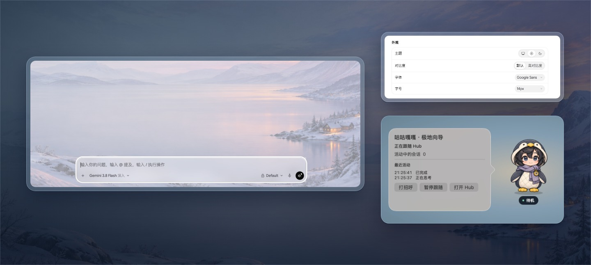

<p align="center"><strong>简体中文</strong> · <a href="docs/README.en.md">English</a></p>

<h1 align="center">Antigravity Hub 中文工具箱</h1>

<p align="center">中文菜单和设置、本地壁纸与磨砂、跟随会话的桌宠。</p>

<p align="center">
  <strong><a href="https://github.com/Fanmili-5/antigravity-hub-zh/releases/download/v0.1.0-alpha.7/antigravity-hub-zh-v0.1.0-alpha.7-source.zip">下载源码 ZIP</a></strong>
  · <a href="#安装汉化">安装汉化</a>
  · <strong><a href="#一键还原">一键还原</a></strong>
</p>

<p align="center"><sub>macOS · Hub 2.34.0 实测 · <a href="https://github.com/Fanmili-5/antigravity-hub-zh/releases/tag/v0.1.0-alpha.7">v0.1.0-alpha.7</a></sub></p>

<p align="center"></p>

<p align="center"><a href="#中文界面">汉化对比</a> · <a href="#壁纸与磨砂">换肤效果</a> · <a href="#桌宠与会话">桌宠实测</a></p>

## 中文界面

菜单、常用设置、模型选择和扩展入口会显示中文。同一版本的「外观」设置对比如下，点图可看原尺寸。

<table>
  <tr>
    <th width="50%">原版英文</th>
    <th width="50%">应用汉化后</th>
  </tr>
  <tr>
    <td><a href="docs/images/localization-original.png"></a></td>
    <td><a href="docs/images/localization-zh.png"></a></td>
  </tr>
</table>

## 壁纸与磨砂

使用本地图片，调节模糊和遮罩。下面是在 Hub 中应用峡湾壁纸后，输入框实际呈现的效果。

[](docs/images/fjord-live.png)

## 桌宠与会话

「咕咕嘎嘎 · 极地向导」可以单独运行。开启工作区联动后，单击桌宠能看到最近的会话状态。下面的「正在思考」和「已完成」来自一次真实 Hub 会话。

<p align="center">
  <a href="docs/images/orbit-activity.png"></a>
</p>

*封面由实测截图拼排。公开图片只保留设置、输入区和活动状态。*

## 安装汉化

目标应用为 `/Applications/Antigravity.app`（Hub）。需要 Python 3.9+、Node.js 22.12+ 和 npm。首次构建可能从 npm 获取固定版本的 `@electron/asar`。

在源码解压目录检查兼容性。检查时 Hub 可以保持打开。

```bash
./install.sh --check
```

检查通过后，按 **⌘Q** 完全退出 Hub，再运行：

```bash
./install.sh && open /Applications/Antigravity.app
```

安装脚本用本机的 Google 签名原版生成补丁，并保留整包备份。汉化规则跳过聊天内容、代码块和终端输出。

## 一键还原

按 **⌘Q** 退出 Hub，在原解压目录运行：

```bash
./restore.sh && open /Applications/Antigravity.app
```

脚本恢复整包原版并验证 Google 签名。原版备份位于 `/Applications/.Antigravity.app-i18n/rollback.app`。补丁使用临时代码签名（ad-hoc），可能影响系统授权或自动更新。升级建议先还原，官方版升级完成后重新检查。 [Google 软件条款](https://policies.google.com/terms#toc-software) · [Antigravity 条款](https://antigravity.google/terms)

## 外观套装和桌宠

首次构建原生工作台或桌宠需要 Xcode Command Line Tools。壁纸和磨砂在装有本项目补丁的 Hub 中生效。

| 想做什么 | 在源码目录执行 |
| --- | --- |
| 预览「峡湾 · 极地向导」 | `python3 pack.py preview fjord --open` |
| 导入、切换、撤回或导出套装 | `python3 pack.py workbench` |
| 单独启动桌宠 | `python3 pet.py start` |
| 恢复默认外观 | `python3 theme.py restore` |

要跟随会话，在工作台的「会话活动」为指定工作区启用联动。 [自定义壁纸](docs/CUSTOMIZATIONS.md) · [用图片创建桌宠](docs/PET_STUDIO.md) · [套装与联动](docs/WORKBENCH.md)

## 兼容性与反馈

| 环境 | 实测范围 |
| --- | --- |
| **Hub 2.34.0** · Apple Silicon · macOS 26.5.1 | 安装、整包还原、主要汉化界面、壁纸与磨砂、桌宠会话联动 |
| **Hub 2.33.0** · 同一台 Mac | 官方副本通过构建、安装与还原 |
| 其他版本、系统或 Intel Mac | 待验证，可先运行 `./install.sh --check` |

部分高级设置、动态内容和第三方界面仍可能显示英文。通过 Skill 操作时，可在 Codex 或 Antigravity 中打开源码目录。 [工具箱 Skill](.agents/skills/antigravity-hub-tools/SKILL.md) · [汉化 Skill](.agents/skills/antigravity-hub-zh/SKILL.md) · [贡献与反馈](CONTRIBUTING.md)

社区维护。Antigravity 和 Google 的标识归各自权利人。 [MIT 许可](LICENSE) · [发行说明](docs/RELEASE_NOTES.md)
