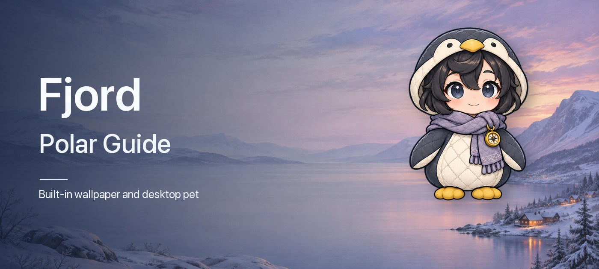

# Antigravity Hub 中文工具箱

**中文界面、自定义壁纸和磨砂，还有一只会跟随真实会话的桌宠。**

给 macOS 上的 Antigravity Hub 做本地汉化和外观自定义。可以只装中文界面，也可以直接启动桌宠。菜单栏工作台用来预览和分享套装、查看正在运行的会话。

[下载源码 ZIP](https://github.com/Fanmili-5/antigravity-hub-zh/releases/download/v0.1.0-alpha.7/antigravity-hub-zh-v0.1.0-alpha.7-source.zip) · [Release](https://github.com/Fanmili-5/antigravity-hub-zh/releases/tag/v0.1.0-alpha.7) · [安装汉化](#安装汉化) · [一键还原](#还原与升级)



*「峡湾 · 极地向导」用内置壁纸和桌宠组合出一套外观。你也可以导入自己的图片。*

| 想做什么 | 从这里开始 |
| --- | --- |
| 把菜单、会话入口和设置换成中文 | [检查兼容性并安装](#安装汉化) |
| 换本地壁纸和磨砂效果 | [预览峡湾套装](#壁纸和磨砂) |
| 启动桌宠，或用自己的图制作一个 | [开始使用桌宠](#桌宠和会话活动) |
| 换回 Google 签名的原版 Hub | [一键还原](#还原与升级) |

## 安装汉化

目标是 `/Applications/Antigravity.app`（Hub）。需要 Python 3.9+、Node.js 22.12+ 与 npm。首次构建可能从 npm 获取固定版本的 `@electron/asar`。

1. 解压源码 ZIP，在解压目录检查兼容性。Hub 可以保持打开。

   ```bash
   ./install.sh --check
   ```

2. 检查通过后，按 **⌘Q** 完全退出 Hub。安装完成后再打开 Hub。

   ```bash
   ./install.sh
   open /Applications/Antigravity.app
   ```

脚本以本机的 Google 签名原版为输入，生成补丁并验证候选副本，安装前保留完整原版备份。中文覆盖原生菜单、会话入口、模型、主要设置和常见扩展。汉化规则跳过用户与助手消息、代码块和终端输出。

## 还原与升级

完全退出 Hub，在同一个源码目录运行：

```bash
./restore.sh
open /Applications/Antigravity.app
```

还原会切回完整原版并校验 Google 签名。备份位于 `/Applications/.Antigravity.app-i18n/rollback.app`。补丁使用临时代码签名（ad-hoc），可能影响系统授权和自动更新。升级 Hub 前可先还原，用官方版升级后重新检查兼容性。 [Google 软件条款](https://policies.google.com/terms#toc-software) · [Antigravity 条款](https://antigravity.google/terms)

## 壁纸和磨砂

桌宠与菜单栏工具需要 Xcode Command Line Tools。先打开「峡湾 · 极地向导」的离线预览，或打开工作台来导入、应用、撤回与导出套装。

```bash
python3 pack.py preview fjord --open
python3 pack.py workbench
```

壁纸和磨砂在已安装补丁的 Hub 内生效。也可以只换壁纸，并保留当前桌宠。

```bash
python3 theme.py apply dusk --image "/path/to/wallpaper.jpg" --veil 78 --blur 12
python3 theme.py restore
```

`theme.py restore` 恢复默认外观。 [换肤指南](docs/CUSTOMIZATIONS.md) · [套装导入与导出](docs/WORKBENCH.md)

## 桌宠和会话活动

```bash
python3 pet.py start
```

桌宠可独立运行。单击可以查看活动或打招呼，也能用自己的图片制作角色。在工作台的「会话活动」选择启用工作区后，桌宠会跟随真实会话，在待机、思考、完成和需要查看之间切换。 [从图片创建桌宠](docs/PET_STUDIO.md) · [会话联动说明](docs/WORKBENCH.md#会话活动)

## 通过 Skill 使用

在 Codex 或 Antigravity 中打开源码目录。可以说「用 antigravity-hub-tools 预览峡湾套装，导出到当前目录」，或让汉化 Skill 先检查兼容性。安装和还原在 Hub 退出后从外部终端执行。 [工具箱 Skill](.agents/skills/antigravity-hub-tools/SKILL.md) · [汉化 Skill](.agents/skills/antigravity-hub-zh/SKILL.md)

## 兼容性

| 环境 | 实测范围 |
| --- | --- |
| **Hub 2.34.0** · Apple Silicon · macOS 26.5.1 | 兼容检查、安装、整包还原。主要汉化界面、壁纸与磨砂、桌宠与真实会话联动 |
| **Hub 2.33.0** · 同一台 Mac | 官方副本通过构建、安装与还原 |
| 其他 Hub 版本、系统或 Intel Mac | 待验证，可先运行 `./install.sh --check` |

高级设置、动态文案和第三方界面仍可能显示英文。 [贡献与反馈](CONTRIBUTING.md)

这是社区项目。源码包包含脚本、词典和项目示例素材，安装补丁由用户在本机生成。Antigravity 和 Google 的标识归各自权利人。 [MIT 许可](LICENSE) · [发行说明](docs/RELEASE_NOTES.md)
