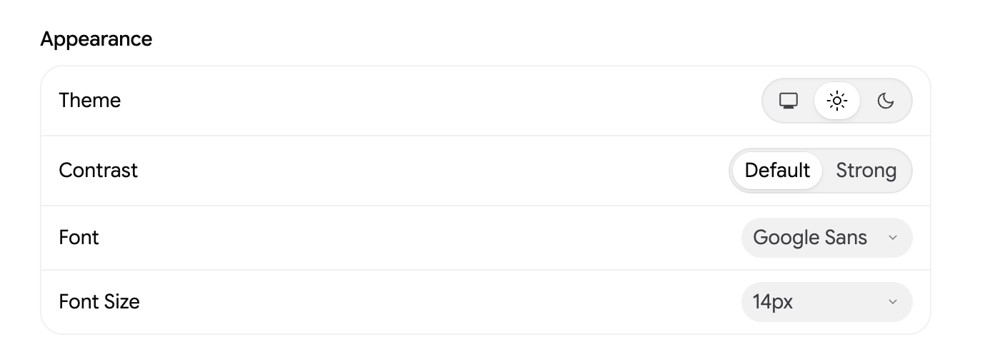
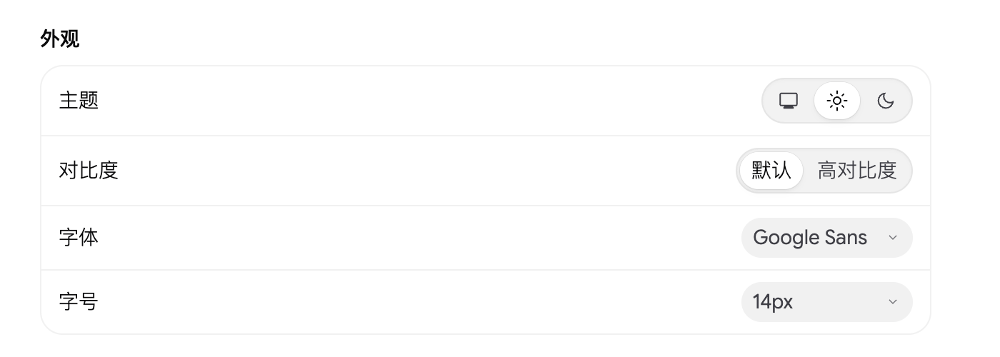
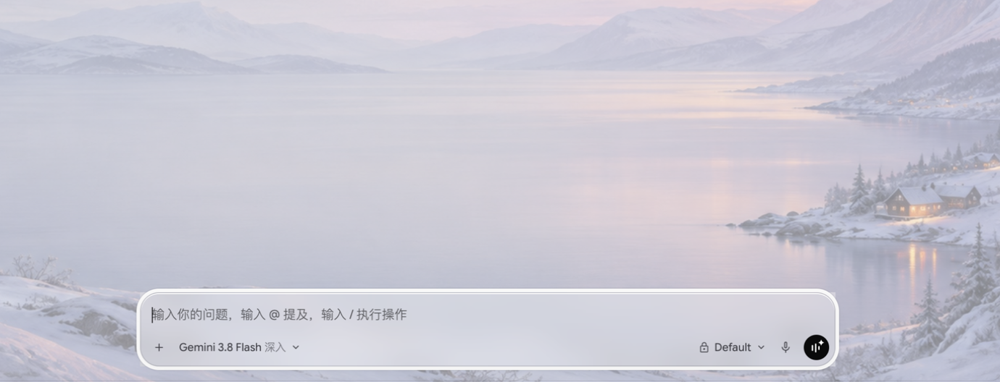
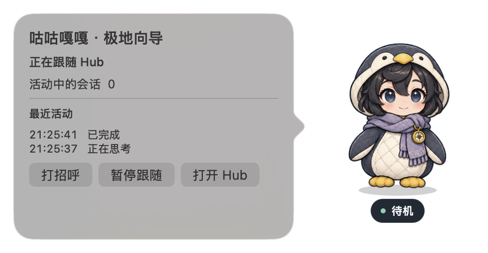

# Antigravity Hub 中文工具箱

**给 Hub 换上中文菜单和设置，用自己的壁纸，再让桌宠跟随会话。**

[**下载源码 ZIP**](https://github.com/Fanmili-5/antigravity-hub-zh/releases/download/v0.1.0-alpha.7/antigravity-hub-zh-v0.1.0-alpha.7-source.zip) · [**一键还原**](#一键还原) · [版本与校验](https://github.com/Fanmili-5/antigravity-hub-zh/releases/tag/v0.1.0-alpha.7)

macOS · Hub **2.34.0** 实测 · 本机生成补丁

[中文界面](#中文界面)　/　[壁纸与磨砂](#壁纸与磨砂)　/　[桌宠与会话](#桌宠与会话)

## 中文界面

菜单、主要设置、模型选择和常用扩展改为中文。下面是同一版本的「外观」设置。

<table>
  <tr>
    <th width="50%">原版英文</th>
    <th width="50%">应用汉化后</th>
  </tr>
  <tr>
    <td><a href="docs/images/localization-original.png"></a></td>
    <td><a href="docs/images/localization-zh.png"></a></td>
  </tr>
</table>

*Hub 2.34.0 实测。两图只保留设置区域，点图可查看原尺寸。*

## 壁纸与磨砂

把本地图片铺进 Hub，调节背景模糊和遮罩。下图用内置峡湾壁纸，输入框上可以看到磨砂效果。

[](docs/images/fjord-live.png)

## 桌宠与会话

「咕咕嘎嘎 · 极地向导」可独立运行。启用工作区联动后，它会跟随会话状态。单击桌宠，可以查看最近活动、暂停跟随或打开 Hub。

<p align="center">
  <a href="docs/images/orbit-activity.png"></a>
</p>

*一次真实 Hub 会话结束后，活动面板记录了「正在思考」和「已完成」。公开截图已裁去聊天内容、账号和项目列表。*

## 安装汉化

目标应用为 `/Applications/Antigravity.app`（Hub）。需要 Python 3.9+、Node.js 22.12+ 和 npm。首次构建可能从 npm 获取固定版本的 `@electron/asar`。

1. 下载并解压源码 ZIP，在解压目录检查兼容性。Hub 可以保持打开。

   ```bash
   ./install.sh --check
   ```

2. 检查通过后，按 **⌘Q** 完全退出 Hub，再执行安装。

   ```bash
   ./install.sh
   open /Applications/Antigravity.app
   ```

脚本从本机的 Google 签名原版生成补丁，并保留完整备份。汉化规则跳过聊天内容、代码块和终端输出。

## 一键还原

按 **⌘Q** 退出 Hub，在同一个解压目录运行：

```bash
./restore.sh
open /Applications/Antigravity.app
```

还原脚本会恢复整包原版并校验 Google 签名。完整备份位于 `/Applications/.Antigravity.app-i18n/rollback.app`。补丁使用临时代码签名（ad-hoc），可能影响系统授权或自动更新。升级前先还原，官方版升级完成后重新检查兼容性。 [Google 软件条款](https://policies.google.com/terms#toc-software) · [Antigravity 条款](https://antigravity.google/terms)

## 换肤、桌宠与套装

首次构建原生工作台或桌宠需要 Xcode Command Line Tools。壁纸与磨砂在安装了本项目补丁的 Hub 中生效，桌宠可单独启动。

| 想做什么 | 终端命令 |
| --- | --- |
| 先看「峡湾 · 极地向导」套装 | `python3 pack.py preview fjord --open` |
| 从工作台导入、切换、撤回或导出套装 | `python3 pack.py workbench` |
| 只启动桌宠 | `python3 pet.py start` |
| 恢复默认外观 | `python3 theme.py restore` |

要跟随真实会话，在菜单栏工作台的「会话活动」启用指定工作区。 [自定义壁纸与磨砂参数](docs/CUSTOMIZATIONS.md) · [用图片制作桌宠](docs/PET_STUDIO.md) · [套装与联动](docs/WORKBENCH.md)

## 通过 Skill 使用

在 Codex 或 Antigravity 中打开源码目录，可以说「预览峡湾套装，然后导出到当前目录」。安装和还原在退出 Hub 后从外部终端执行。 [工具箱 Skill](.agents/skills/antigravity-hub-tools/SKILL.md) · [汉化 Skill](.agents/skills/antigravity-hub-zh/SKILL.md)

## 兼容性与反馈

| 环境 | 实测范围 |
| --- | --- |
| **Hub 2.34.0** · Apple Silicon · macOS 26.5.1 | 兼容检查、安装、整包还原，主要汉化界面、壁纸与磨砂、桌宠会话联动 |
| **Hub 2.33.0** · 同一台 Mac | 官方副本通过构建、安装与还原 |
| 其他版本、系统或 Intel Mac | 待验证，可先运行 `./install.sh --check` |

部分高级设置、动态内容和第三方界面仍可能显示英文。欢迎反馈漏译，附上 Hub 版本和界面位置即可。 [贡献指南](CONTRIBUTING.md)

这是社区项目。Antigravity 和 Google 的标识归各自权利人。 [MIT 许可](LICENSE) · [发行说明](docs/RELEASE_NOTES.md)
