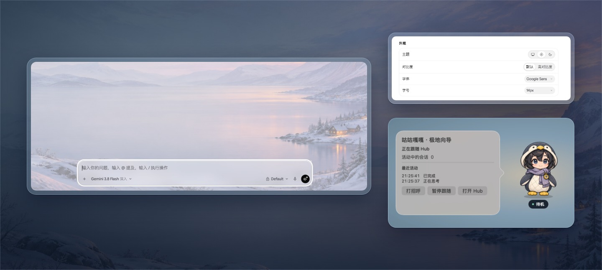
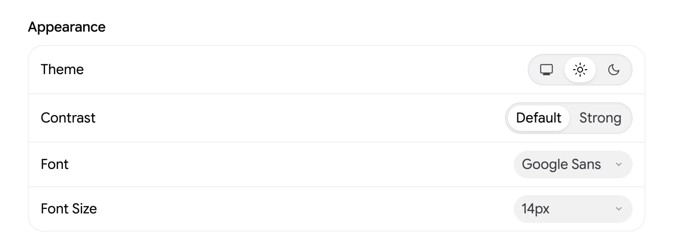
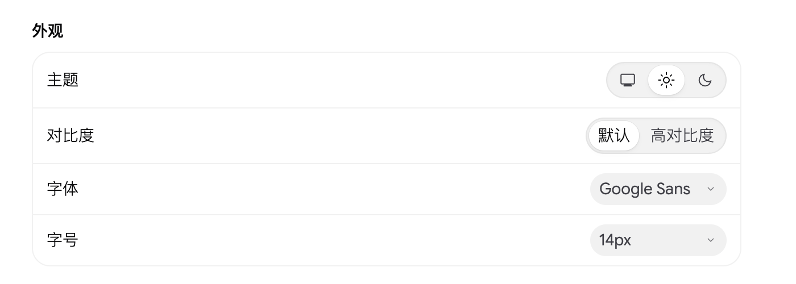
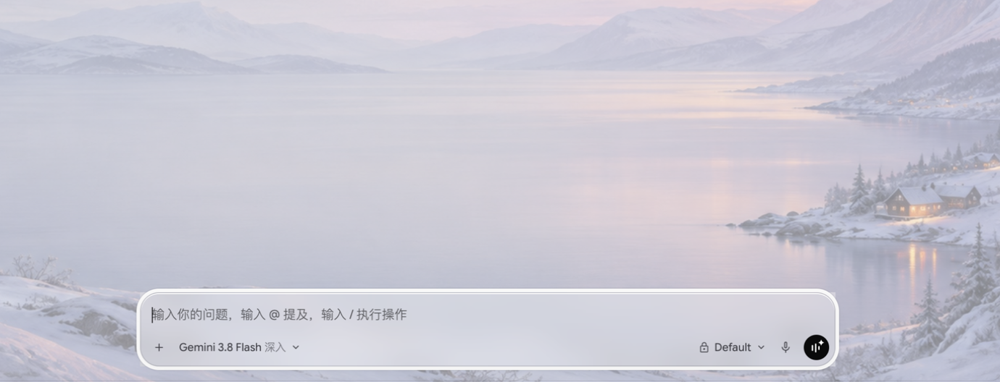
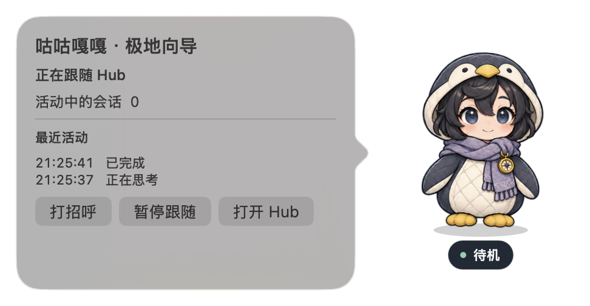

<p align="center"><a href="../README.md">简体中文</a> · <strong>English</strong></p>

<h1 align="center">Antigravity Hub Toolkit</h1>

<p align="center">Simplified Chinese menus and settings, custom wallpaper and glass, and a desktop pet that follows your sessions.</p>

<p align="center">
  <strong><a href="https://github.com/Fanmili-5/antigravity-hub-zh/releases/download/v0.1.0-alpha.7/antigravity-hub-zh-v0.1.0-alpha.7-source.zip">Download source ZIP</a></strong>
  · <a href="#install">Install</a>
  · <strong><a href="#restore">Restore</a></strong>
</p>

<p align="center"><sub>macOS · Tested on Hub 2.34.0 · <a href="https://github.com/Fanmili-5/antigravity-hub-zh/releases/tag/v0.1.0-alpha.7">v0.1.0-alpha.7</a></sub></p>

<p align="center"></p>

<p align="center"><a href="#simplified-chinese">Localization</a> · <a href="#wallpaper-and-glass">Wallpaper</a> · <a href="#desktop-pet">Desktop pet</a></p>

## Simplified Chinese

The patch translates menus, common settings, model selection, and frequently used extension controls. Select either image to see the same Appearance panel at full size.

<table>
  <tr>
    <th width="50%">Original English</th>
    <th width="50%">With Chinese localization</th>
  </tr>
  <tr>
    <td><a href="images/localization-original.png"></a></td>
    <td><a href="images/localization-zh.png"></a></td>
  </tr>
</table>

## Wallpaper and glass

Use a local image and adjust the blur and tint. This Hub screenshot shows the bundled Fjord wallpaper behind the translucent composer.

[](images/fjord-live.png)

## Desktop pet

Polar Guide can run on its own. Enable session tracking for a workspace, then click the pet to see recent activity. The thinking and completed entries below came from a live Hub session.

<p align="center">
  <a href="images/orbit-activity.png"></a>
</p>

*The cover combines screenshots. It shows only the settings, composer, and activity panel.*

## Install

The patch targets `/Applications/Antigravity.app` (Hub). It requires Python 3.9+, Node.js 22.12+, and npm. The first build may fetch the pinned `@electron/asar` version from npm.

In the extracted source directory, check compatibility. Hub can stay open for this check.

```bash
./install.sh --check
```

After the check passes, quit Hub with **⌘Q**, then run:

```bash
./install.sh && open /Applications/Antigravity.app
```

The installer builds the patch from your Google-signed app and backs up the complete original. Localization skips conversation content, code blocks, and terminal output.

## Restore

Quit Hub with **⌘Q**, then run from the same directory:

```bash
./restore.sh && open /Applications/Antigravity.app
```

The script restores the original bundle and verifies Google's signature. The backup lives at `/Applications/.Antigravity.app-i18n/rollback.app`. The patch uses ad-hoc signing, which may affect macOS permissions or automatic updates. Restore before upgrading and rerun the compatibility check afterward. [Google software terms](https://policies.google.com/terms#toc-software) · [Antigravity terms](https://antigravity.google/terms)

## Appearance packs and desktop pet

The workbench and pet can run on their own. The first launch builds `dist/Orbit Pet.app` using Python 3.9+ and Xcode Command Line Tools. If the tools are missing, run `xcode-select --install`. Once the app starts, open the workbench from the sparkle icon in the menu bar. Wallpaper and glass take effect on the Hub chat screen after you install the patch.

| Task | Run from the source directory |
| --- | --- |
| Preview the Fjord and Polar Guide pack | `python3 pack.py preview fjord --open` |
| Import, switch, undo, or export packs | `python3 pack.py workbench` |
| Start the pet on its own | `python3 pet.py start` |
| Restore the default appearance | `python3 theme.py restore` |

To follow sessions, open the workbench and enable the workspace under **会话活动** (Session Activity). [Wallpaper guide (中文)](CUSTOMIZATIONS.md) · [Make a pet from an image (中文)](PET_STUDIO.md) · [Workbench guide (中文)](WORKBENCH.md)

## Compatibility

| Environment | Verified scope |
| --- | --- |
| **Hub 2.34.0** · Apple Silicon · macOS 26.5.1 | Install, full restore, common UI translations, wallpaper and glass, and pet session tracking |
| **Hub 2.33.0** · same Mac | Built, installed, and restored a separate official app copy |
| Other Hub versions, macOS versions, or Intel Macs | Run `./install.sh --check` |

Some advanced settings, dynamic labels, and third-party controls may still appear in English. To use a Skill from Codex or Antigravity, open the source directory. [Toolkit Skill](../.agents/skills/antigravity-hub-tools/SKILL.md) · [Localization Skill](../.agents/skills/antigravity-hub-zh/SKILL.md) · [Contributing (中文)](../CONTRIBUTING.md)

Community-maintained. Antigravity and Google marks belong to their respective owners. [MIT license](../LICENSE) · [Release notes](https://github.com/Fanmili-5/antigravity-hub-zh/releases/tag/v0.1.0-alpha.7)
